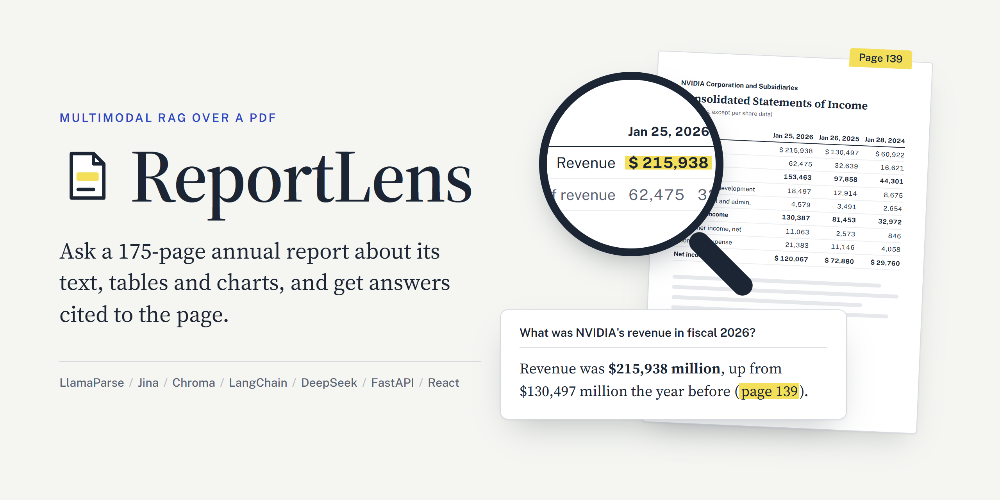

# ReportLens



ReportLens is a retrieval-augmented generation pipeline for PDF documents that contain text, tables, and images. It answers questions using all three, not only the text, and cites the pages it used.

## How it works

**Ingestion** turns a PDF into a searchable vector store:

1. **Parse.** [LlamaParse](https://developers.llamaindex.ai/llamaparse/parse/getting_started) reads each page with a vision model and returns it as markdown, with tables as HTML. It also crops the figures from each page. The result is saved, so the PDF is parsed only once.
2. **Chunk.** Each page is split at its headings into chunks. A short section joins the next one, so a heading never stands alone, and a table is never cut.
3. **Describe.** Every chart and diagram is sent to a vision model with the text of its page, and the model writes a searchable description of it. Other cropped images, such as photos, logos and signatures, are skipped.
4. **Store.** The text chunks and the chart descriptions are embedded and saved in a local [Chroma](https://www.trychroma.com/) vector store, each with its page number. A chart also keeps the path of its image.

**Generation** is agentic. The answering model is given document search as a tool and decides for itself when to use it:

1. **Decide.** The model reads the question. A greeting or a question about the assistant itself is answered directly, and a request that has nothing to do with the document is declined.
2. **Search.** Otherwise the model calls the search tool, which fetches the most relevant chunks and charts. It can search again with a different query if the first results fall short.
3. **Answer.** The model answers from the text, tables, and chart images it found, citing their pages. If the document does not hold the answer, it says so.

**Chat.** A FastAPI backend keeps the last 3 questions and answers of each conversation in memory, so follow-up questions such as "And the year before?" work. A React web UI shows each answer with its cited pages, the retrieved figures, and the retrieved text of each page.

## Setup

Python 3.12 or 3.13. Install the Python packages:

```bash
python -m venv .venv
source .venv/bin/activate
pip install -r requirements.txt
```

The web UI needs Node.js (developed with Node 22). Install its packages:

```bash
cd frontend
npm install
```

Create a `.env` file in the project root with your API keys:

```
LLAMA_CLOUD_API_KEY=...
DEEPSEEK_API_KEY=...
JINA_API_KEY=...
```

- `LLAMA_CLOUD_API_KEY` is used for parsing (LlamaParse).
- `DEEPSEEK_API_KEY` is used for chart descriptions and answer generation.
- `JINA_API_KEY` is used for embeddings.

To trace each question in [LangSmith](https://smith.langchain.com) (optional; the free plan is enough), add:

```
LANGSMITH_TRACING=true
LANGSMITH_API_KEY=...
LANGSMITH_PROJECT=multimodal-rag-pipeline
```

Each question then appears as a trace with its model calls, searches, retrieved chunks, token counts and cost, and the questions of one API conversation are grouped in the project's Threads tab. The project is created by the first trace.

The off-topic evaluation in `evals/notebooks/off_topic_eval.ipynb` is judged by Liquid AI's `d1.1` decision model. To run it, also add `LIQUID_API_KEY=...`.

## Usage

Run these commands from the project root.

Ingest the document set in `config.py`:

```bash
python -m multimodal_rag.ingest
```

The first run parses the PDF with LlamaParse, which costs 10 credits a page on the `agentic` tier, and describes its figures. Both results are saved in `parsed/<document name>/` and reused by later runs. Delete that folder to parse again. Each ingestion run replaces the contents of the vector store.

Ask the test questions and print the searches the model made, the retrieved chunks, the model name, and the answer:

```bash
python -m multimodal_rag.generate
```

The test questions are the `TEST_QUESTIONS` list at the top of `multimodal_rag/generate.py`.

Start the chatbot API, with a single worker:

```bash
uvicorn multimodal_rag.api:app
```

Then ask a question, and send the returned `conversation_id` with a follow-up so the model sees the earlier turns (`-N` shows the answer as it streams in):

```bash
curl -N -X POST http://127.0.0.1:8000/ask -H "Content-Type: application/json" \
  -d '{"question": "What were NVIDIA'"'"'s revenue and net income in fiscal year 2026?"}'

curl -N -X POST http://127.0.0.1:8000/ask -H "Content-Type: application/json" \
  -d '{"question": "And the year before?", "conversation_id": "<id from the first answer>"}'
```

The answer streams as server-sent events: `search` with each search the model starts, `text` with each new piece of the answer, and last `done`, with the `conversation_id`, the whole answer and its sources. A search means the text before it was the model's lead-in ("I'll look that up"), not the answer. If DeepSeek or Jina fails, the stream ends with an `error` event instead.

The server keeps the last 3 questions and answers of each conversation in memory, so conversations are lost when it restarts. A chart from the answer is served at `/` + its `image_path`, and `GET /health` reports that the server is up. The interactive API docs are at http://127.0.0.1:8000/docs.

### Web UI

The UI in `frontend/` is a React app (Vite, TypeScript, Tailwind CSS and shadcn/ui). It writes each answer as it streams in, with the searches the model makes, then shows its page citations, the retrieved figures, and the retrieved text of each cited page.

While working on it, run the API as above and, in a second terminal, the Vite dev server, which reloads the page on every change:

```bash
cd frontend
npm run dev
```

Open http://localhost:5173. The dev server forwards `/ask`, `/health` and the chart images to the API on port 8000.

To use the UI without the dev server, build it, and build it again after changing it. The API then serves it at http://127.0.0.1:8000/:

```bash
cd frontend
npm run build
```

To use the pipeline from your own code:

```python
from multimodal_rag.generate import answer_question, build_agent

agent = build_agent()
result = answer_question(agent, "Your question here")
print(result["answer"])
```

`answer_question` returns a dictionary with `question`, `answer`, `model`, `search_queries`, and `chunks`. `search_queries` is empty when the model answered without searching. Each chunk has `id` (such as `page139-2`, the 2nd chunk of page 139), `score`, `page_number`, `printed_page_number` (empty when the page has none), `text`, and `image_path`. `image_path` is set only for a chart, and `text` is then its description. Pass `history=[{"question": ..., "answer": ...}]` to give it the earlier turns of a conversation, and `thread_id` to group a conversation's traces in LangSmith.

To follow the answer as it is written, use `stream_answer` with the same arguments. It yields `(kind, data)` pairs, the events the API streams, and last `("done", result)`, the dictionary above:

```python
from multimodal_rag.generate import build_agent, stream_answer

agent = build_agent()
for kind, data in stream_answer(agent, "Your question here"):
    if kind == "search":
        print(f"\n[searching: {data['query']}]")
    elif kind == "text":
        print(data["text"], end="", flush=True)
```

## Configuration

Every setting lives in `multimodal_rag/config.py`:

| Setting | What it controls |
|---|---|
| `DOCUMENT_PATH` | The PDF to ingest |
| `DOCUMENT_TITLE` | The document's name, which the chatbot uses to introduce itself and in its answers |
| `PARSED_DIRECTORY` | Where the parse result, the cropped images, and the chart descriptions are saved |
| `VECTOR_STORE_DIRECTORY` | Where the Chroma vector store is saved |
| `PARSE_TIER` | LlamaParse tier |
| `DEEPSEEK_BASE_URL` | DeepSeek's API, used for chart descriptions and answers |
| `IMAGE_DESCRIPTION_MODEL` | Vision model that describes charts (DeepSeek) |
| `EMBEDDING_MODEL` | Text embedding model (Jina) |
| `GENERATION_MODEL` | Model that decides when to search and writes the answer, seeing the retrieved charts (DeepSeek) |
| `RETRIEVED_CHUNK_COUNT` | How many chunks each search returns |
| `MIN_RELEVANCE_SCORE` | Chunks scoring below this are left out of the search results |
| `CHAT_HISTORY_TURNS` | How many earlier turns of a conversation the model sees |
| `MAX_CONVERSATIONS` | How many conversations the API keeps in memory |
| `DESCRIPTION_MAX_TOKENS` | Longest description the vision model may write |
| `EMBEDDING_BATCH_SIZE` | Documents embedded per request during ingestion, one request a minute |
| `MODEL_RETRY_ATTEMPTS` | Retries for a rate-limited or unavailable model call |
| `MIN_CHUNK_CHARACTERS` | A section shorter than this joins the next one |

`2026-Annual-Report-Web.pdf` in this repository is NVIDIA's 2026 annual report, the document used during development. Point `DOCUMENT_PATH` at any PDF to use your own, set `DOCUMENT_TITLE` to its name, and update the document's title, page count and example questions for the web UI in `frontend/src/lib/document.ts`.

## Project layout

```
multimodal_rag/
  config.py     all settings, loads .env
  store.py      Chroma vector store and embedding model
  ingest.py     ingestion pipeline: runs the four steps below in order
  parse.py      1. parse the PDF with LlamaParse, once, and save the result and the cropped images
  chunking.py   2. split each page into text chunks at its headings
  figures.py    3. pick the charts among the cropped images and describe them
  generate.py   agent that answers questions, with document search as its tool
  api.py        FastAPI chatbot backend, keeps each conversation's recent turns in memory
frontend/       web UI: React, Vite, TypeScript, Tailwind CSS and shadcn/ui
  src/App.tsx         the conversation: questions, answers, new chat
  src/components/     the question box, each exchange, its sources and figures, markdown with page citations
  src/lib/api.ts      the call to POST /ask, reading its event stream, and error messages
  src/lib/document.ts the document's title, page count and example questions
evals/          evaluation with deepeval
  goldens/            golden sets: questions with reference answers and their pages
  notebooks/          the notebooks that run them, with their results
  findings/           a write-up of each experiment
notebooks/      experiments the pipeline grew out of
parsed/         saved parse results, cropped images and chart descriptions (not in git)
```

## Status

Ingestion, generation and the chatbot API work for a single document: NVIDIA's 2026 annual report (175 pages), which becomes 377 text chunks and 12 chart descriptions. All 6 test questions in `generate.py` are answered correctly, and the API answers follow-up questions within a conversation. The web UI works in development and as a build served by the API, and every question can be traced in LangSmith.
